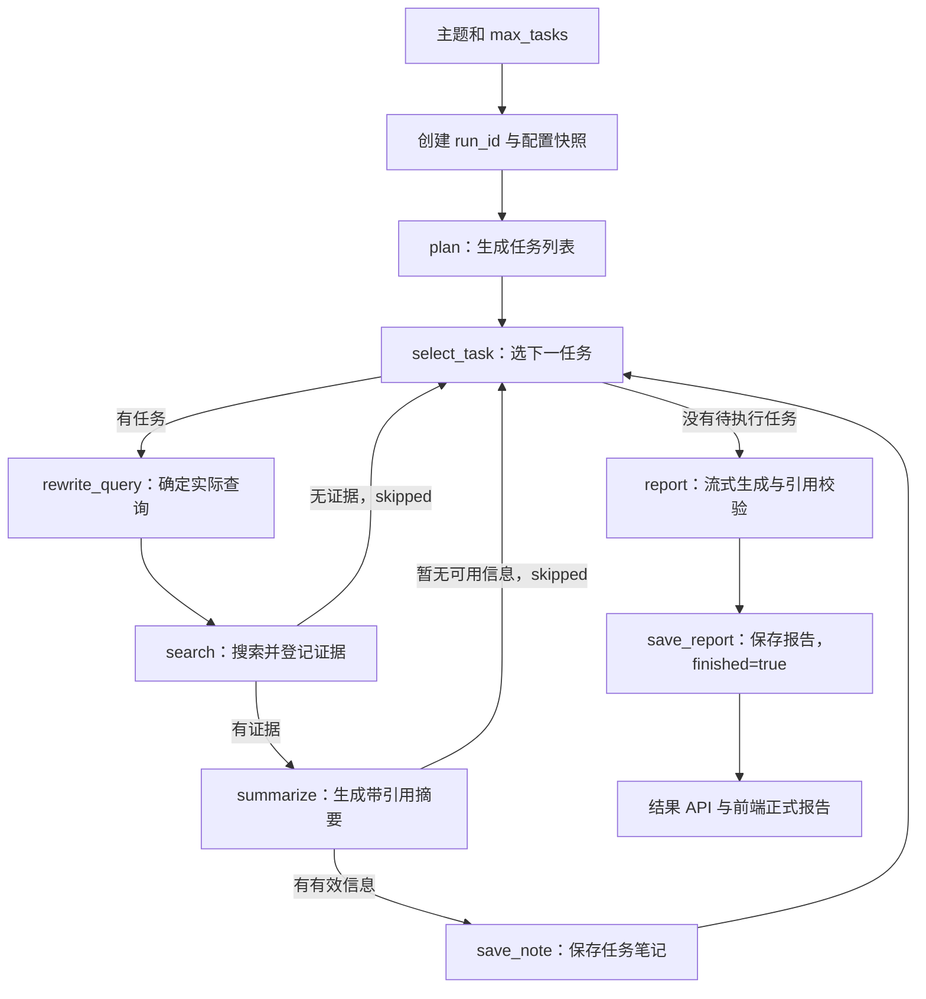

# query-rewrite-citation-v2：恢复说明与研究数据流

## 本次恢复到了哪里

后端以 `evals/runs/20261112T142932Z-0b427b5c/source_snapshot/` 为准。该批次标签是 `query-rewrite-citation-v2`，评测记录的源码指纹为 `a79e3ad70d8c790915a52fec75ed2ea32a28c8497f144d3544441288db25da20`。

评测时的 HEAD 是 `18dc8b4`，但当时工作区已存在尚未提交的查询改写代码，因此不能简单回到那个提交。前端、测试和非快照文件使用随后提交的 `3b67b76`；后端 52 个快照文件已逐个核验 SHA-256。

只有两个运行文件额外添加了回退兼容处理：

- `graph/graph_researcher.py`：读取后续版本历史报告时，复制 payload 并移除 v2 不识别的 `review_status`，不修改数据库；未知的其他字段仍会报错。
- `api/manager.py`：后续版本配置的未完成研究返回 409，提示按原主题新建研究，避免用 v2 接着执行已不存在的反思节点。直接 Python 续跑也会被原有配置快照校验阻止。

新建研究的规划、查询改写、搜索、证据登记、摘要和报告逻辑均为 v2。没有恢复证据语义筛选、独立正文提取、反思、摘要修正和质量状态字段。

工作区恢复后 Git HEAD 没有移动，回退表现为相对当前提交的工作区差异。没有强制重写历史，也未创建提交。备份目录为：

```text
backend/data/pre-v2-rollback-20261113T125531Z/
  metadata.txt                       原 HEAD 和恢复目标
  current-worktree.patch             回退前未提交的已跟踪改动
  commits-after-query-rewrite.patch   v2 提交之后的已提交改动
  untracked/                         后续新增但未提交的源码、测试、文档
  query-rewrite-citation-v2.tar       3b67b76 的只读 Git 归档
  demo_deepresearcher.py              本地 demo 修改前副本
```

`.env`、笔记、运行数据库和已有评测批次保持原位。后续版本的已完成报告可查看；未完成记录不要跨版本续跑。更新后需要重启后端和前端开发服务。新建研究统一使用 `GraphDeepResearcher` 或 FastAPI；历史手写 `deep_researcher.py`、`repository.py` 属于 v2 快照中的旧代码，不是当前图入口。

验收结果：主流程 72 项离线测试、2 项回退兼容测试、23 项前端端到端测试通过，前端生产构建通过。真实研究 `8819ebb31f8542e28efbed86615b9b80` 完整执行 3 个任务，保存 15 条证据和最终报告；自动引用结构检查通过。输出位于 `backend/data/diagnostics/v2-rollback-20261113T130128Z/`。这次真实运行验证功能恢复，不等同于再次完成 v2 的人工质量评测。

全量 pytest 收集仍会被 v2 自带的 `test_logging_config.py` 阻止：它导入了旧仓储所依赖但已不存在的 ResearchRecord。旧笔记/手写工作流测试没有在本次重新迁移，因此不能宣称全量测试通过。可用以下命令复测已验证的图主线：

```powershell
cd backend
uv run python -m pytest tests/test_query_rewriting.py tests/test_citation_normalization.py tests/test_streaming.py tests/test_evals.py tests/test_utils.py tests/test_tools tests/test_v2_rollback.py -q
```

## 一条主流程



## 数据在哪里

| 对象 | 负责保存什么 | 生命周期 |
|---|---|---|
| `RunInfo` | run_id、主题、非敏感配置、任务上限、运行状态、错误 | runs.sqlite3 中的研究元数据 |
| `ResearchGraphState` | payload、active_task_id、max_tasks、finished、版本 | LangGraph 检查点 |
| `SummaryState` | 主题、全部任务、全局来源与证据、报告和笔记关联 | payload 还原出的业务对象 |
| `TodoItem` | 单个任务的标题、意图、原查询、实际查询、状态、摘要、证据引用与笔记关联 | SummaryState.todo_items |
| `Source` | 来源编号、页面 URL、标题 | SummaryState.sources |
| `Evidence` | 证据编号、来源编号、归属任务、实际片段、时间、查询和后端 | SummaryState.evidence |
| `EvidenceBatch` | 合并后的全部来源/证据，以及本次任务选中的编号 | 搜索服务的临时返回值 |
| `CitedText` | 规范化后的正文和实际引用编号 | 摘要/报告服务的临时返回值 |
| `SummaryStateOutput` | run_id、报告、任务、来源、证据和报告引用 | Python 入口的最终返回值 |

`payload` 是 `SummaryState` 的可序列化字典，不是另一份需要手动同步的业务模型。`encode_state()` 使用 `dataclasses.asdict()`，递归转成字典；`decode_state()` 还原 dataclass，并检查证据归属和引用范围。`finished` 在图顶层，不在 SummaryState。

## 1. 输入主题，建立研究身份

前端提交 `POST /api/research`，数据主要是：

```json
{"topic": "图像处理的主要技术有哪些呢", "max_tasks": 3}
```

API 将参数交给 ResearchManager。Manager 调用 `create_run()`，分配 32 位 run_id，将主题、任务上限和非敏感配置存进 runs.sqlite3，然后将执行放入线程池队列。HTTP 202 立即返回 run_id 和查询地址，报告此时还没生成。

直接使用 Python 时，`GraphDeepResearcher.run()` 内部也先 create_run，再执行研究。执行器为本次执行分配 execution_id，取得 run_id 对应文件锁，创建图、模型资源和 SQLite checkpointer。

新研究的图状态类似：

```python
{
    "version": 1,
    "payload": {
        "run_id": "...",
        "research_topic": "图像处理的主要技术有哪些呢",
        "todo_items": [],
        "sources": {},
        "evidence": {},
        # 其余字段采用 SummaryState 默认值。
    },
    "active_task_id": None,
    "max_tasks": 3,
    "finished": False,
}
```

## 2. 规划：模型工具参数变成 TodoItem

PlanningService 为 ToolAwareAgent 注册 `generate_research_tasks`。它是结构化结果提交工具，参数是 tasks 列表，每项有 title、intent、query。

监听器的数据流如下：

1. Agent 向模型发送系统提示词、主题与日期，以及工具参数 Schema。
2. 模型返回原生 tool_calls，其中 `function.arguments` 是 JSON 字符串。
3. ToolAwareAgent 解析并执行注册的虚拟工具。该工具只返回“已接受多少任务”的确认文本，不写研究状态。
4. 工具执行完成触发 `tool_call_listener`。PlanningService 临时安装的监听器只接受名称匹配且 success 为真的事件。
5. 监听器解析 `raw_parameters`，把 tasks 保存到服务函数内部的 `parsed_tasks`。已有监听器仍会收到转发事件。
6. Agent 可以继续将工具结果发给模型取得最终文字，但真正使用的规划数据来自捕获的工具参数。
7. PlanningService 将 parsed_tasks 转成 `list[TodoItem]`，finally 中恢复原监听器。没取得有效任务时使用一个兜底任务。
8. plan 节点执行 `state.todo_items = 返回的任务列表`，由图统一提交检查点。

监听器不写数据库、不存笔记、不把任务直接置为完成。

## 3. 选任务和改写查询

select_task 在任务上限范围内找到第一个未 completed/skipped 的任务，将其状态置为 running，并返回 `active_task_id`。

QueryRewriteService 的输入是主题、任务标题、意图和原始 query，输出一条查询字符串。成功、关闭功能和失败回退都会确定一个查询；图节点将结果写入 `task.search_query`。

```python
task.query = "图像处理基本概念原理"                # 规划原文不覆盖
task.search_query = "图像处理主要技术 基本概念 原理"  # 实际搜索词
query = task.effective_query                       # 优先使用 search_query
```

effective_query 是派生属性，不额外保存第三份查询。查询改写节点提交后，搜索失败重试会复用已保存的实际查询。

## 4. 搜索：网页结果变成可追踪的证据

SearchService 使用 effective_query 调用 SearchTool，后者将结果规范化为带 url、title、content 等字段的列表。v2 当前配置使用 Tavily、最多 5 条结果、`fetch_full_page=False`，因此以搜索摘要作为材料；没有 v3 后的额外正文提取和语义筛选阶段。

EvidenceService.collect() 依次：

- 复制 state.sources 和 state.evidence 的容器，保留之前任务的全部内容。
- 检查 URL 和非空材料，同 URL 复用 Source；对本任务相同证据去重。
- 按 evidence_max_chars 截取实际材料，默认 2000 **字符**，并记录 truncated。
- 创建 Evidence，写入 source_id、task_id、text、retrieved_at、实际 query、backend、kind。
- 返回 EvidenceBatch。

例如处理完第二个任务：

```python
batch.sources      # 任务 1 + 任务 2 的累计来源目录
batch.evidence     # E0001 ... E0010，全部任务累计证据
batch.evidence_ids # 仅本次任务的 E0006 ... E0010
```

节点再执行：

```python
state.sources = batch.sources
state.evidence = batch.evidence
task.evidence_ids = list(batch.evidence_ids)
task.notices = list(batch.notices)
```

这里虽然是赋值，**不会丢失旧任务证据**，因为 batch 中的全局目录已包含旧数据。没有可用证据时，该任务 skipped，进入下一任务。

## 5. 摘要：证据变成带编号的结论

SummarizationService 根据 task.evidence_ids 取得本任务材料。EvidenceService.context() 返回 JSON 字符串，其中包含编号、来源信息和实际证据文本。服务把它与研究主题、标题、意图、实际查询放进摘要提示词。

SimpleAgent 返回摘要文本后，EvidenceService.prepare_text() 先将确定可转换的合写引用规范化，再检查编号格式、存在性和是否属于本任务。

```text
模型输出：[E0001, E0002]
规范结果：[E0001][E0002]
```

程序不猜编号，不修补不存在的证据。校验通过返回：

```python
CitedText(text="结论正文 [E0001]", citation_ids=("E0001",))
```

节点把正文和编号写入 task.summary、task.citation_ids。evidence_ids 是“允许用的证据”，citation_ids 是“实际用了哪些”。固定资料不足响应没有 citation_ids，会进入 skipped。v2 没有语义反思，引用结构合法不代表结论一定正确。

## 6. 笔记：先成功保存，再标记任务完成

save_note 调用 NoteService，输入仍是 state 和 task_id。NoteService 用任务元数据、摘要和实际引用条目拼出完整笔记正文，然后调用 NoteTool.save()。

NoteTool 按 run_id + task_id 生成稳定文件名，先写临时文件，再原子替换正式文件。首次创建就写入真实摘要；重复保存覆盖同一笔记。模型不决定是否保存，也没有笔记监听器参与回填。

保存成功返回 Note；节点将 note_id、note_path 写回任务，然后将 task.status 置为 completed。保存失败不会先将任务标为完成。关闭笔记时不写文件，节点仍可完成任务。

主流程下一步是 select_task，继续下一个任务。它不从笔记重新拼回摘要，任务状态中已经有正式正文。

## 7. 报告：完成的摘要和实际证据一起进入模型

没有待执行任务后，ReportingService 只选择 completed 且有摘要的任务。它再次校验这些摘要，汇总摘要中实际引用的证据编号，作为报告允许引用的范围。

模型输入包含主题、完成任务的摘要和这些编号对应的证据原文。因此数据流是：

```text
已完成任务的 summary + summary 中实际引用的 Evidence
                         ↓
                   报告模型
                         ↓
                流式正文分片 → 临时草稿
                         ↓
              合并、引用规范化与范围校验
                         ↓
            程序附加引用证据条目与研究范围说明
```

生成中的 report.delta 用于前端草稿，正式数据还没提交。完整文本校验通过后，report 节点更新 `state.structured_report` 和 `state.report_citation_ids`。

随后 save_report 保存报告笔记，回填 report_note_id、report_note_path，返回 `finished=True`。图没有待执行节点且最终报告非空时，report_ready 才为真。运行元数据最后标为 completed。

## 8. 前端怎样拿数据

- `GET /api/research/{run_id}`：状态、当前任务、待执行节点、各任务证据数和引用数，前端定时核对。
- `GET /api/research/{run_id}/events`：SSE 节点事件和报告分片，带事件游标，断线可以重放。
- `GET /api/research/{run_id}/result`：正式报告、任务摘要，以及报告真正引用的证据/来源。
- `GET /api/research/{run_id}/report`：下载正式 Markdown。

引用按钮的数据关联是：`[E0001] → state.evidence['E0001'] → evidence.source_id → state.sources[source_id] → URL`。前端同时展示已保存片段，用户可以核对程序当时实际给模型的材料。

## 9. 每一步怎样保存，失败怎样恢复

每个节点外面都有 bind() 包装：读取 payload → decode_state → 调用服务 → 节点更新业务字段 → encode_state → 返回图更新。LangGraph 使用同步检查点，在已提交节点之后继续。

例如 search 已提交而 summarize 失败，resume(run_id) 会继续 summarize；query、sources、evidence 不会重新生成。运行中硬终止需要确认旧进程已停止后使用 recover_interrupted=True。

笔记写入、事件数据库和检查点不是同一个跨存储事务。笔记已写入但检查点未提交时，恢复可能重复保存；稳定文件名使该操作可重复。模型请求也可能在故障后重复，因此不能把恢复理解为外部请求绝对只发生一次。
