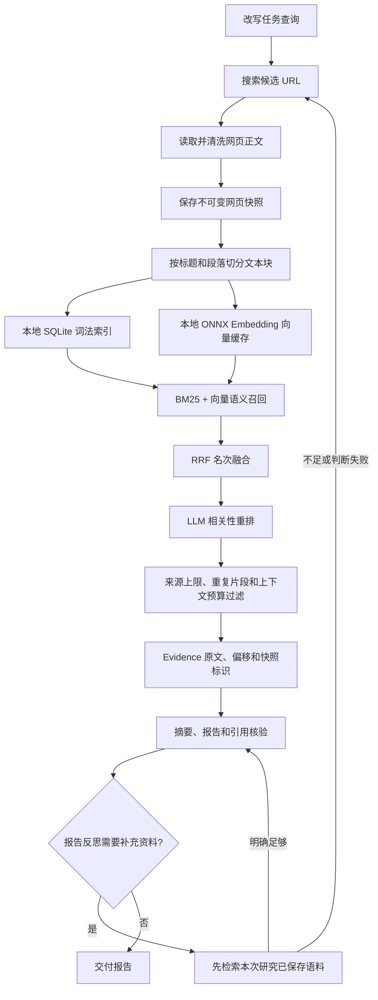

# Web RAG

## 目标与边界

新研究默认使用网页检索增强生成。系统把搜索结果当作候选来源，再读取正文、保存不可变快照、切分文本、混合召回、融合排序、模型重排，最后只把选中的原文片段交给摘要和报告生成。旧检查点没有 Web RAG 配置时，恢复会沿用旧搜索节点，避免在半途中改变研究流程。

这实现的是**公开网页资料的研究级 RAG**，不是用户私有文档库，也不是搜索引擎本身。搜索和正文提取由 Tavily 提供；当前不会绕过登录、付费墙或站点访问控制。Tavily 不可用时会保留搜索片段并标记限制，不会把片段伪装成已读取的完整网页。

## 一次任务的数据流



**正文快照**保存在 `WEB_RAG_WORKSPACE/<run_id>/corpus.sqlite3`。LangGraph 检查点只保存任务阶段、计数和 Evidence 关联，不把整批网页全文塞进状态。SQLite 中的 `pages`、`chunks`、`vectors` 和 `records` 分别保存正文、切片、向量和各节点的阶段结果；固定阶段结果按键写入，恢复时可从失败节点继续，不需要重新搜索已经完成的阶段。

每条 Evidence 记录指向 `snapshot_id`、`chunk_id`、文本区段和原文字符偏移。页面更新会生成新的内容哈希和快照，旧引用仍指向旧快照。研究详情 API 可返回来源快照，前端引用抽屉能标出实际使用的原文位置。

## 检索设计

- **BM25**处理关键词、专名和配置项；中文由 jieba 分词。文本块全部保留词法检索，不受向量编码数量上限影响。
- **Embedding**默认使用本机 `BAAI/bge-small-zh-v1.5` ONNX 模型，通过 FastEmbed CPU 编码。首次使用会下载约 90 MB 模型到 `EMBEDDING_CACHE_DIR`。同一文本的向量按模型签名缓存到研究 SQLite。
- **RRF**只融合 BM25 和向量召回的名次，不把不同量纲的原始分数直接相加。
- **模型重排**逐候选核对问题和原文，分数范围是 0 到 3。输出必须包含完整候选编号；不完整时会要求模型完整修正一次，再失败就保留融合排序并在任务限制中明确说明。
- **证据预算**限制候选数、最终片段数、单来源片段数和输入字符数。精确重复及同页高度重叠片段会被去重。
- **补充研究**先检索当前 run 已保存的全部网页。只有模型明确判定现有证据足够才跳过联网；格式错误或判断失败按“不足”处理。

这些约束保证来源可追溯和执行有界，不保证搜索结果真实、召回完整或报告质量自动提高。模型重排和覆盖判断仍属于模型判断；必须结合固定题集的人工评分观察实际收益。

## 配置

应用现有的 `backend/.env` 仍需设置 `LLM_PROVIDER`、`LLM_MODEL_ID`、`LLM_BASE_URL`、`LLM_API_KEY`、`SEARCH_API=tavily` 和 `TAVILY_API_KEY`。以下 Web RAG 项均有可用默认值；需覆盖默认值时再写入 `.env`：

```dotenv
ENABLE_WEB_RAG=true
WEB_RAG_WORKSPACE=./data/web_rag
WEB_RAG_MAX_PAGES=5
WEB_RAG_PAGE_CHARS=60000
WEB_RAG_CHUNK_CHARS=450
WEB_RAG_OVERLAP_CHARS=60
WEB_RAG_MAX_CHUNKS=160
WEB_RAG_CANDIDATES=16
WEB_RAG_TOP_K=8
WEB_RAG_CONTEXT_CHARS=9000
WEB_RAG_PER_SOURCE=3
WEB_RAG_TIMEOUT=90
WEB_RAG_CACHE_HOURS=24

EMBEDDING_BACKEND=local
EMBEDDING_MODEL=BAAI/bge-small-zh-v1.5
EMBEDDING_CACHE_DIR=./data/models
EMBEDDING_DIMENSIONS=512
ENABLE_EMBEDDINGS=true
ENABLE_RERANK=true
```

环境变量名是配置字段的大写形式。默认本地向量不需要另一个模型 API 密钥，也不会把网页正文发给 Embedding 服务。可将 `ENABLE_EMBEDDINGS=false` 关闭语义召回，系统仍保留 BM25；可将 `ENABLE_RERANK=false` 关闭模型重排。使用兼容 OpenAI Embedding API 时，设置 `EMBEDDING_BACKEND=api`、`EMBEDDING_MODEL`、`EMBEDDING_DIMENSIONS` 和 `EMBEDDING_BASE_URL`；同一 LLM 端点可复用 `LLM_API_KEY`，独立端点必须显式设置 `EMBEDDING_API_KEY`。API 向量不是默认路径。

参数由 [config.py](../src/deep_researcher/config.py) 校验。分块长度以字符为单位；当前默认 450 字符适配本地 512-token 模型。调大分块长度时也要核对所选模型的输入 token 上限，否则向量模型可能截去块尾部，BM25 仍会使用完整原文。

## 运行和检查

在 PowerShell 的 `backend` 目录运行：

```powershell
uv sync --extra dev
uv run python demo/demo_graphresearcher.py
uv run pytest tests/test_web_rag.py -q
```

demo 研究完成或失败都会输出 `run_id`。研究状态保存在原有 SQLite 检查点中，网页资料则在 `data/web_rag/<run_id>/corpus.sqlite3`。检查点失败后调用项目现有 `resume(run_id)` 流程，会复用已提交阶段记录；不要直接删除运行中研究的 SQLite 文件。

可通过以下只读接口排查证据和阶段产物：

```text
GET /api/research/{run_id}/result
GET /api/research/{run_id}/retrieval/{task_id}
GET /api/research/{run_id}/evidence/{evidence_id}/snapshot
```

删除研究时，管理器会删除该研究自己的 `corpus.sqlite3`，保留可供其他研究复用的模型缓存。固定题集运行会把资料库放在自己的批次目录中；批次目录已由 `.gitignore` 排除。

离线回归包含分块偏移、BM25/语义融合、输出校验及修正、向量缓存、正文读取降级、阶段恢复、补充任务先查本地语料、API 快照和删除清理。两道真实 dev 题的烟测已验证搜索、正文提取、摘要、报告迭代和导出都能完成；自动规则通过，但人工质量评分尚未填写，因此烟测不能证明报告质量优于旧版本。真实调用会带来模型和 Tavily 用量；尤其模型重排为每个检索阶段额外调用一次，补充任务也会增加调用和延迟。

固定题集使用方法见 [评测说明](../evals/README.md)。
